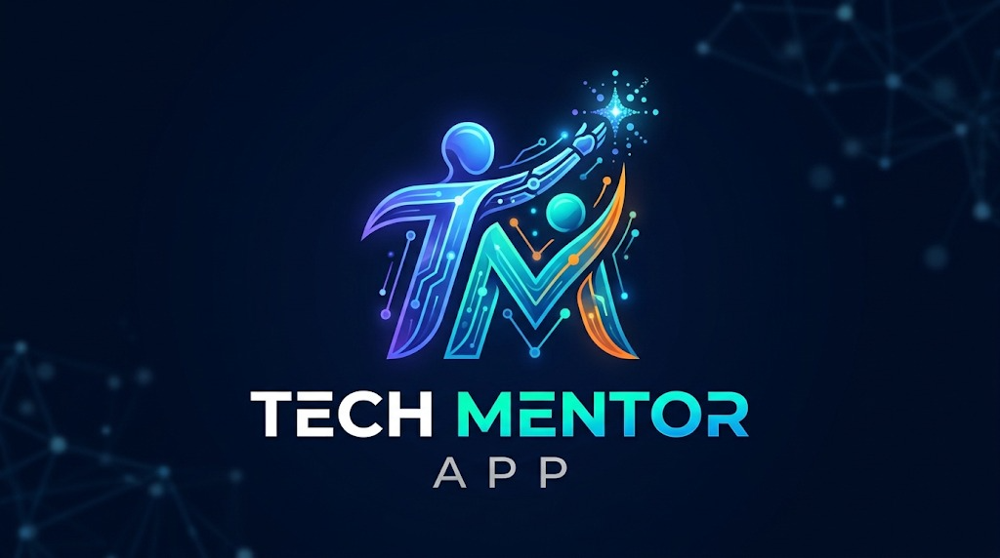

<p align="center">
  
</p>

<h1 align="center">🌿 TechSaathi</h1>

<p align="center">
  <strong>Technology Made Simple. Independence Made Possible.</strong>
</p>

<p align="center">
  AI-powered digital literacy &amp; banking education for parents, grandparents, and first-time smartphone users.
</p>

<p align="center">
  <a href="https://techsaathi-app.vercel.app">
    
  </a>
  &nbsp;
  <a href="https://vimeo.com/user232312804/techsaathi?share=copy&fl=sv&fe=ci">
    
  </a>
  &nbsp;
  <a href="https://github.com/SyedMuhammadHunain/tech-mentor">
    
  </a>
</p>

<p align="center">
  
  
  
  
  
  
  
  
  
  
</p>

---

## 🌐 Live Links

| What | Link |
|------|------|
| 📲 **Download the APK** | **[https://techsaathi-app.vercel.app](https://techsaathi-app.vercel.app)** |
| 🎬 **Product demo video** | [Watch on Vimeo](https://vimeo.com/user232312804/techsaathi?share=copy&fl=sv&fe=ci) |
| 💻 **Source code** | [github.com/SyedMuhammadHunain/tech-mentor](https://github.com/SyedMuhammadHunain/tech-mentor/) |

> Tap **Download the application** on the live site to get `TechSaathi.apk` on phone, tablet, or PC.

---

## ✨ Why TechSaathi?

Many people struggle with phones and digital banking because apps feel complicated.  
TechSaathi does **not** do everything for them — it **teaches** them, step by step, so they become independent.

**Tagline:** *Don't just help them use technology. Teach them to understand it.*

---

## 🚀 Features

<table>
  <tr>
    <td width="50%">
      <h3>🤖 AI Teacher</h3>
      Ask anything about technology in <b>English</b>, <b>Urdu</b>, or <b>Roman Urdu</b>. Supports text + voice input/output with Gemini.
    </td>
    <td width="50%">
      <h3>🏦 Banking Saathi</h3>
      14 beginner banking lessons — balance, IBAN, beneficiaries, transfers, bills, JazzCash, Easypaisa, scams &amp; more.
    </td>
  </tr>
  <tr>
    <td>
      <h3>🧪 Demo Bank Practice Lab</h3>
      Fully fictional bank simulator. Practise transfers safely.<br/>
      <b>SIMULATION ONLY — NO REAL MONEY.</b>
    </td>
    <td>
      <h3>🛡️ ScamShield</h3>
      Paste a suspicious SMS / WhatsApp message and get a clear risk explanation with recommended actions.
    </td>
  </tr>
  <tr>
    <td>
      <h3>📱 Explain My Screen</h3>
      Upload a screenshot and TechSaathi explains buttons, fields, and safe next steps.
    </td>
    <td>
      <h3>📚 Learn + My Progress</h3>
      Small lessons, quizzes, streaks, badges, and independence tracking based on real practice.
    </td>
  </tr>
</table>

### Also included
- Friendly onboarding (language, experience, learning style)
- Large accessible UI (big text, 56px+ touch targets, high contrast)
- Profile & accessibility settings (text size, voice preferences)
- Local progress on device (no login / no Firebase Auth)

---

## 🎨 Brand & Design

| Token | Value |
|-------|-------|
| Primary | `#168C83` |
| Soft teal | `#DDF3EF` |
| Background | `#F8FAF9` |
| Text | `#24332F` |
| Font | Noto Sans (+ Noto Nastaliq Urdu) |

Built for beginners: light mode by default, simple navigation, clear labels, and patient teaching language.

---

## 🧱 Tech Stack

```text
Flutter + Dart
Riverpod  ·  GoRouter  ·  Google Fonts
Gemini AI (google_generative_ai + HTTP fallback)
speech_to_text  ·  flutter_tts  ·  image_picker
Firebase Core + Cloud Firestore (optional, no Auth)
Vercel (APK download landing page)
```

---

## 📂 Project Structure

```text
lib/
  app/           # theme, router, MaterialApp
  core/          # constants, l10n, services, widgets
  data/          # models + repositories
  features/      # onboarding, home, ai_teacher, banking,
                 # practice_lab, scamshield, screen_explainer,
                 # learning, progress, profile
website/         # one-page APK download site (Vercel)
```

---

## 🛠️ Run Locally

```bash
flutter pub get
flutter analyze
flutter test
flutter run
```

### Live Gemini

```bash
flutter run --dart-define=GEMINI_API_KEY=YOUR_KEY
flutter build apk --release --dart-define=GEMINI_API_KEY=YOUR_KEY
```

### Download website (local)

```bash
# from repo root
python -m http.server 8080 --directory website
# open http://localhost:8080
```

---

## 🔥 Firebase (optional, no login)

Progress can sync with Firestore using a **device id** — there is **no authentication**.

1. Create Android app with id `com.techsaathi.techsaathi_ai`
2. Add `google-services.json` to `android/app/`
3. Apply Google Services Gradle plugin
4. Deploy `firestore.rules`

Until Firebase is configured, everything still works offline on-device.

---

## 🔒 Safety First

- ❌ Never asks for ATM PIN, OTP, password, CVV, or card credentials  
- ❌ No real bank connections / no real money  
- ✅ Demo Bank is clearly labelled as simulation  
- ✅ Screenshots are not stored permanently  
- ✅ ScamShield never claims a message is “guaranteed safe”

---

## 📦 Release

| Artifact | Location |
|----------|----------|
| Live download page | [techsaathi-app.vercel.app](https://techsaathi-app.vercel.app) |
| Local APK | `build/app/outputs/flutter-apk/app-release.apk` |
| Website APK copy | `website/TechSaathi.apk` |

---

## 🤝 Contributing

See [CONTRIBUTING.md](CONTRIBUTING.md) and our [Code of Conduct](CODE_OF_CONDUCT.md).

---

## 📄 License

MIT — see [LICENSE](LICENSE).

---

<p align="center">
  <b>Made with patience for every first-time learner.</b><br/>
  <i>Don't just help them use technology. Teach them to understand it.</i>
</p>

<p align="center">
  <a href="https://techsaathi-app.vercel.app">⬇️ Download TechSaathi</a>
  ·
  <a href="https://vimeo.com/user232312804/techsaathi?share=copy&fl=sv&fe=ci">▶️ Watch Demo</a>
  ·
  <a href="https://github.com/SyedMuhammadHunain/tech-mentor">⭐ Star on GitHub</a>
</p>
